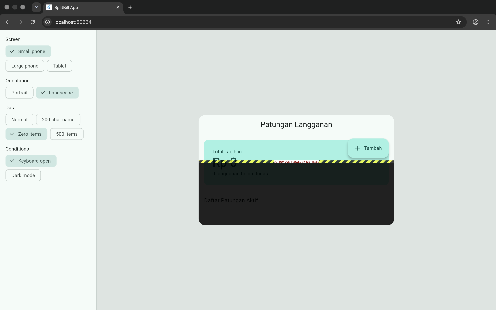
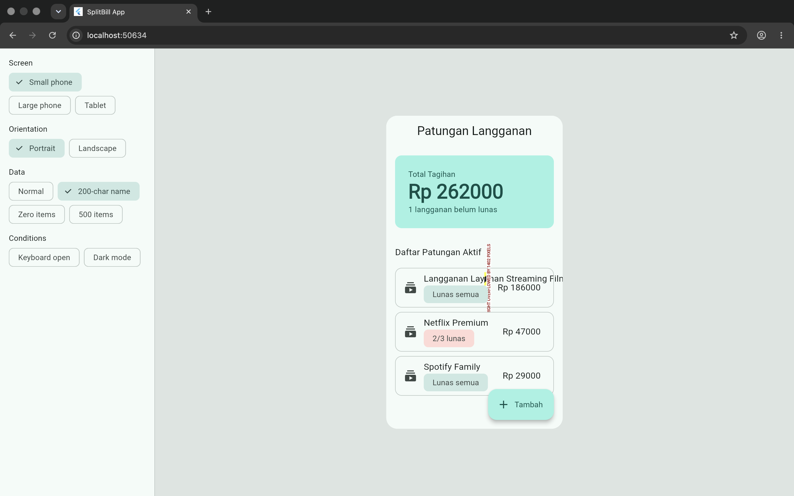
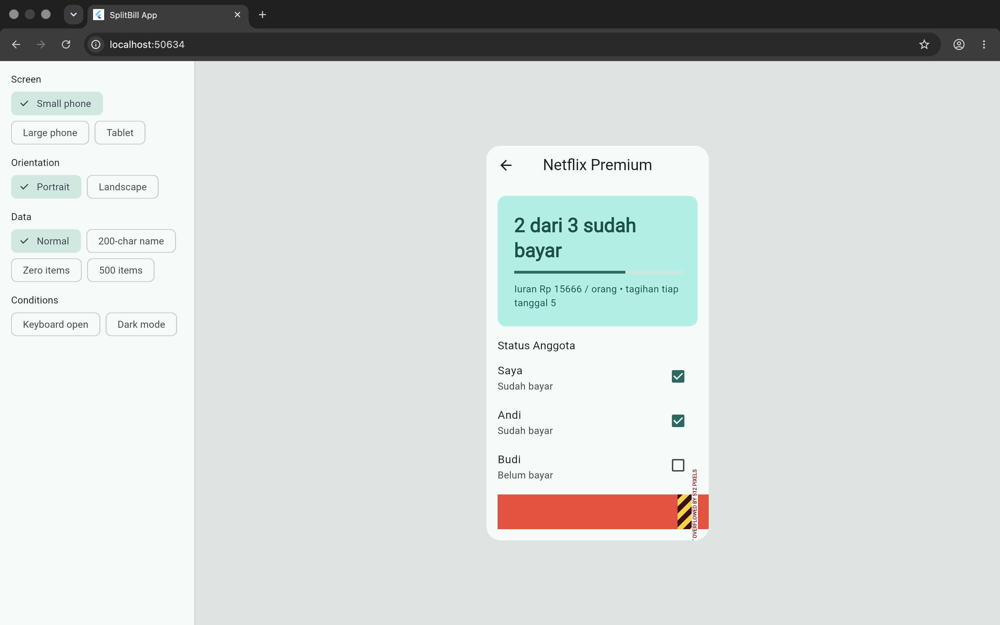

### H2 — Constraint Diagnosis

| Screenshot | Penjelasan Pelanggaran Constraint (1 Kalimat) | Cara Memperbaiki |
| :--- | :--- | :--- |
|  | Induk `Column` memaksakan tata letak statis dan tidak memiliki sifat scrollable, sehingga ketika tinggi area layar mengecil akibat munculnya keyboard di mode landscape, elemen anak di dalamnya melewati batas ruang vertikal. | Mengubah struktur hierarki dari `Column` statis menjadi scrollable widget yang mendukung elemen fleksibel, seperti menggunakan `CustomScrollView` beserta anak-anak slivers. |
|  | `Row` meminta elemen di dalamnya untuk menentukan ukuran lebarnya sendiri secara tak terbatas, sehingga elemen `Text` yang panjang merentang terus hingga menembus batas kanan layar. | Menghapus `Row` yang membungkus teks tersebut dan mengembalikan pengaturan batas teks dengan menambahkan properti `maxLines: 1` serta `overflow: TextOverflow.ellipsis`. |
|  | Sebuah elemen memaksakan ukuran mutlak (`width: 800`) di dalam `Row` yang memberikan kebebasan spasial, sehingga ukurannya menembus batas maksimal lebar layar perangkat. | Menghapus widget statis tersebut dan membungkus elemen tombol dengan `SizedBox(width: double.infinity)` agar lebarnya tunduk dan menyesuaikan dengan sisa ruang yang disediakan oleh parent-nya. |